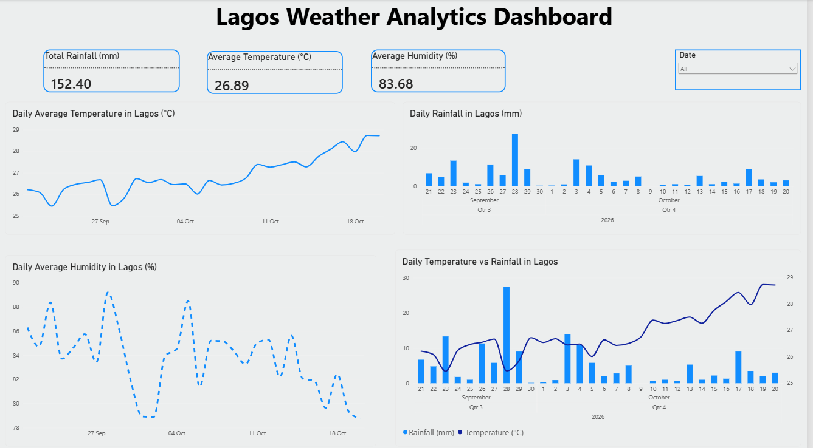

# Lagos Weather API Analytics

## Project Overview

This project analyzes 30 days of historical weather data for Lagos, Nigeria, retrieved using the Open-Meteo API.

Python was used to collect, clean, analyze, and visualize weather data, including temperature, relative humidity, and precipitation.

An interactive Power BI dashboard was also developed to visualize weather trends and communicate key insights.

## Project Objectives

1. Retrieve 30 days of historical weather data for Lagos, Nigeria, using the Open-Meteo API.
2. Clean and prepare the data for analysis using Python and Pandas.
3. Analyze daily temperature, rainfall, and humidity patterns.
4. Investigate relationships between weather variables using correlation analysis.
5. Identify the hottest and rainiest days during the study period.
6. Develop an interactive Power BI dashboard to visualize weather trends and communicate key insights.

## Tools and Technologies

- Python
- Pandas
- Matplotlib
- Seaborn
- Open-Meteo API
- Jupyter Notebook / VS Code
- Power BI

## Data Collection and Preparation

Historical weather data was retrieved from the Open-Meteo API for Lagos, Nigeria.

The dataset includes:
- Temperature (°C)
- Relative Humidity (%)
- Precipitation (mm)
- Date and time

The data was prepared for analysis using Pandas, including checking data quality and aggregating weather observations into daily summaries.

## Exploratory Data Analysis (EDA)

Exploratory data analysis was performed to understand weather patterns and relationships between variables.

The analysis included:
- Daily average temperature trends
- Daily average relative humidity
- Daily rainfall patterns
- Temperature and humidity scatter plot
- Correlation analysis using a heatmap
- Identification of extreme weather days

## Key Findings

### Temperature and Humidity

Temperature and relative humidity showed a strong negative correlation (-0.84), indicating that relative humidity generally decreased as temperature increased.

### Rainfall Relationships

Precipitation showed a weak negative correlation with temperature (-0.20) and a weak positive correlation with relative humidity (0.23).

### Hottest Day

October 19, 2026, recorded the highest daily average temperature of approximately 28.73°C.

### Rainiest Day

September 28, 2026, recorded the highest daily precipitation of 27.3 mm.

## Power BI Dashboard

An interactive Power BI dashboard was developed to present the weather analysis.

The dashboard includes:

- Total Rainfall: 152.40 mm
- Average Temperature: 26.89°C
- Average Relative Humidity: 83.68%
- Daily Average Temperature Trend
- Daily Rainfall Distribution
- Daily Average Humidity Trend
- Temperature vs. Rainfall Comparison
- Interactive Date Filter

The dashboard allows users to explore weather trends and compare different weather variables over the study period.

## Project Files

- `weather_api_analysis.ipynb` — Python data collection, cleaning, analysis, and visualizations.
- `lagos_weather_data.csv` — Weather dataset.
- `Lagos_Weather_Analytics_Dashboard.pbix` — Interactive Power BI dashboard.

## Conclusion

This project demonstrates an end-to-end weather analytics workflow, from retrieving data through an API to cleaning, exploratory data analysis, visualization, and dashboard development.

The analysis revealed a strong negative relationship between temperature and relative humidity, while precipitation showed weaker correlations with both variables.

Combining Python and Power BI provided a comprehensive approach to analyzing and communicating Lagos weather patterns.

